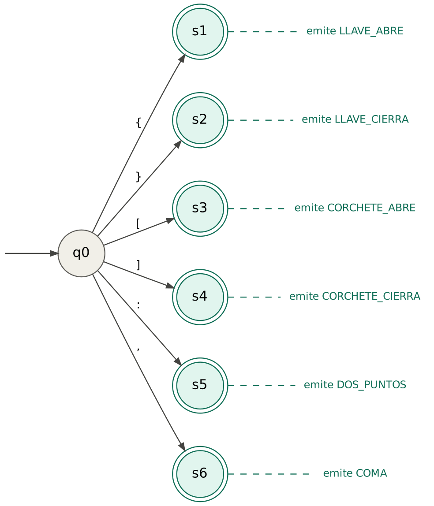
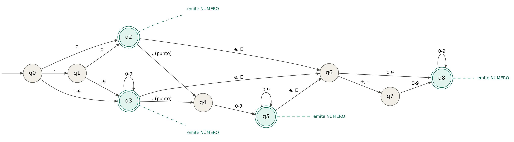
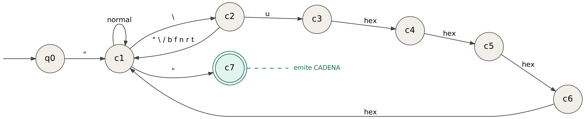
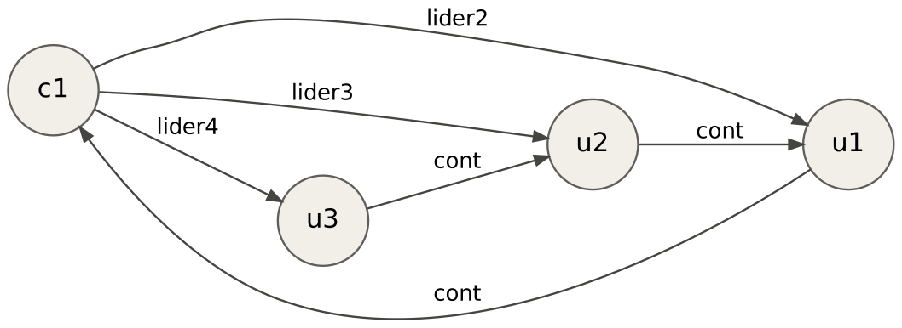
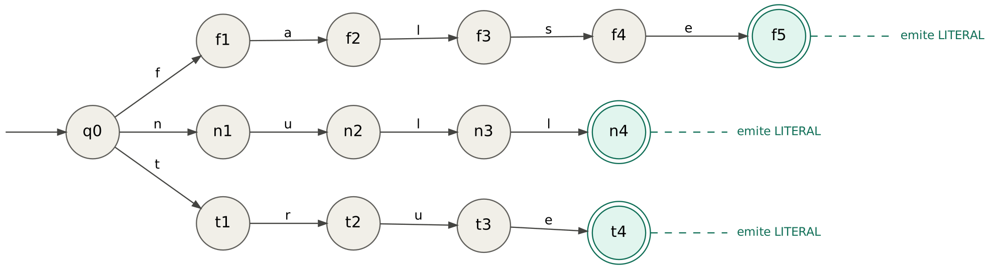
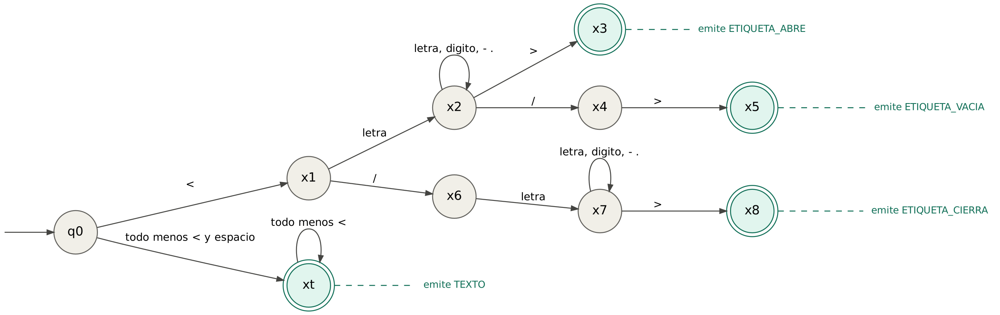

# Fase 1: analisis lexico

Documento generado por `docs/generar_docs.py` a partir de las tablas de `compilador/lexer.py`. No se edita a mano: si cambia una tabla, se vuelve a generar.

## 1. Alfabeto

El alfabeto de entrada son los 256 valores posibles de un byte. Para que las tablas sean pequenas, los bytes se agrupan en clases: el automata no pregunta "que byte es" sino "de que clase es".

### Clases de bytes para JSON (37 clases)

| Clase | Bytes (hexadecimal) | Que es |
|---|---|---|
| `control` | 00-08, 0B-0C, 0E-1F | caracteres de control; prohibidos dentro de una cadena |
| `salto` | 09-0A, 0D | tabulador, salto de linea, retorno de carro |
| `espacio` | 20 | espacio |
| `otro` | 21, 23-2A, 3B-40, 47-5A, 5E-60, 67-6B, 6D, 6F-71, 76-7A, 7C, 7E-7F | resto de ASCII imprimible (letras g-z sin papel especial, signos...) |
| `comilla` | 22 | comilla doble |
| `mas` | 2B | + |
| `coma` | 2C | , |
| `menos` | 2D | - |
| `punto` | 2E | . |
| `diagonal` | 2F | / |
| `cero` | 30 | 0 |
| `digito` | 31-39 | 1 a 9 |
| `dos_puntos` | 3A | : |
| `hex_may` | 41-44, 46 | A, B, C, D, F (hexadecimal) |
| `E_may` | 45 | E mayuscula (exponente y hexadecimal) |
| `corchete_abre` | 5B | [ |
| `barra` | 5C | barra invertida |
| `corchete_cierra` | 5D | ] |
| `a` | 61 | la letra a |
| `b` | 62 | la letra b |
| `c` | 63 | la letra c |
| `d` | 64 | la letra d |
| `e` | 65 | la letra e |
| `f` | 66 | la letra f |
| `l` | 6C | la letra l |
| `n` | 6E | la letra n |
| `r` | 72 | la letra r |
| `s` | 73 | la letra s |
| `t` | 74 | la letra t |
| `u` | 75 | la letra u |
| `llave_abre` | 7B | { |
| `llave_cierra` | 7D | } |
| `cont` | 80-BF | byte de continuacion de un caracter UTF-8 |
| `invalido` | C0-C1, F5-FF | bytes que nunca aparecen en UTF-8 valido |
| `lider2` | C2-DF | primer byte de un caracter UTF-8 de 2 bytes |
| `lider3` | E0-EF | primer byte de un caracter UTF-8 de 3 bytes |
| `lider4` | F0-F4 | primer byte de un caracter UTF-8 de 4 bytes |

Grupos que se usan como abreviatura en tablas, diagramas y gramaticas:

- `0-9` o `[0-9]`: las clases `cero` y `digito`.
- `hex` o `HEX`: digitos hexadecimales, 0-9, a-f, A-F.
- `ESC`: lo que puede seguir a una barra invertida: `" \ / b f n r t`.
- `normal` o `NORMAL`: cualquier byte ASCII imprimible (20 a 7F) excepto la comilla y la barra invertida.

### Clases de bytes para XML (8 clases)

| Clase | Bytes (hexadecimal) | Que es |
|---|---|---|
| `otro` | 00-08, 0B-0C, 0E-1F, 21-2C, 3A-3B, 3D, 3F-40, 5B-5E, 60, 7B-FF | cualquier otro byte |
| `espacio` | 09-0A, 0D, 20 | espacio, tabulador, salto de linea, retorno |
| `guion_punto` | 2D-2E | guion y punto |
| `diagonal` | 2F | / |
| `digito` | 30-39 | 0 a 9 |
| `menor` | 3C | < |
| `mayor` | 3E | > |
| `letra` | 41-5A, 5F, 61-7A | A-Z, a-z y guion bajo |

## 2. Tokens

| Lenguaje | Token | Ejemplo |
|---|---|---|
| JSON | LLAVE_ABRE, LLAVE_CIERRA | `{` `}` |
| JSON | CORCHETE_ABRE, CORCHETE_CIERRA | `[` `]` |
| JSON | DOS_PUNTOS, COMA | `:` `,` |
| JSON | CADENA | `"hola"` |
| JSON | NUMERO | `-3.5e10` |
| JSON | LITERAL | `true` `false` `null` |
| XML | ETIQUETA_ABRE | `<id>` |
| XML | ETIQUETA_CIERRA | `</id>` |
| XML | ETIQUETA_VACIA | `<activo/>` |
| XML | TEXTO | `Ana Ruiz` |

Los espacios fuera de las cadenas (y entre etiquetas, en XML) no generan token. Un JSON Schema es un documento JSON, asi que el lexer del esquema es el mismo lexer de JSON.

## 3. Automatas y gramaticas regulares

Todos los automatas comparten el estado inicial q0. Cada gramatica se obtiene del automata con una regla mecanica: por cada flecha de A a B con el simbolo c se escribe `<A> -> c <B>`, y si B es de aceptacion se agrega `<A> -> c`.

### JSON: simbolos de un byte



| Estado | Significado | Aceptacion |
|---|---|---|
| q0 | esperando un token nuevo | no |
| s1 | lei { | LLAVE_ABRE |
| s2 | lei } | LLAVE_CIERRA |
| s3 | lei [ | CORCHETE_ABRE |
| s4 | lei ] | CORCHETE_CIERRA |
| s5 | lei : | DOS_PUNTOS |
| s6 | lei , | COMA |

| Estando en | Si leo | Paso a |
|---|---|---|
| q0 | `{` | s1 |
| q0 | `}` | s2 |
| q0 | `[` | s3 |
| q0 | `]` | s4 |
| q0 | `:` | s5 |
| q0 | `,` | s6 |

Gramatica regular:

```
<q0> -> "{" | "}" | "[" | "]" | ":" | ","
```

### JSON: numeros



| Estado | Significado | Aceptacion |
|---|---|---|
| q0 | esperando un token nuevo | no |
| q1 | lei el signo; falta el primer digito | no |
| q2 | lei un 0 | NUMERO |
| q3 | leyendo la parte entera | NUMERO |
| q4 | lei el punto; falta al menos un decimal | no |
| q5 | leyendo decimales | NUMERO |
| q6 | lei la e; falta el exponente | no |
| q7 | lei el signo del exponente; faltan sus digitos | no |
| q8 | leyendo el exponente | NUMERO |

| Estando en | Si leo | Paso a |
|---|---|---|
| q0 | `-` | q1 |
| q0 | `0` | q2 |
| q0 | `1-9` | q3 |
| q1 | `0` | q2 |
| q1 | `1-9` | q3 |
| q2 | `.` | q4 |
| q2 | `e, E` | q6 |
| q3 | `0-9` | q3 |
| q3 | `.` | q4 |
| q3 | `e, E` | q6 |
| q4 | `0-9` | q5 |
| q5 | `0-9` | q5 |
| q5 | `e, E` | q6 |
| q6 | `+, -` | q7 |
| q6 | `0-9` | q8 |
| q7 | `0-9` | q8 |
| q8 | `0-9` | q8 |

Gramatica regular:

```
<q0> -> "-" <q1> | "0" <q2> | "0" | [1-9] <q3> | [1-9]
<q1> -> "0" <q2> | "0" | [1-9] <q3> | [1-9]
<q2> -> "." <q4> | [eE] <q6>
<q3> -> [0-9] <q3> | [0-9] | "." <q4> | [eE] <q6>
<q4> -> [0-9] <q5> | [0-9]
<q5> -> [0-9] <q5> | [0-9] | [eE] <q6>
<q6> -> [+-] <q7> | [0-9] <q8> | [0-9]
<q7> -> [0-9] <q8> | [0-9]
<q8> -> [0-9] <q8> | [0-9]
```

### JSON: cadenas con escapes



| Estado | Significado | Aceptacion |
|---|---|---|
| q0 | esperando un token nuevo | no |
| c1 | dentro de una cadena | no |
| c2 | lei una barra invertida; falta la letra del escape | no |
| c3 | lei \u; faltan 4 digitos hexadecimales | no |
| c4 | lei \u; faltan 3 digitos hexadecimales | no |
| c5 | lei \u; faltan 2 digitos hexadecimales | no |
| c6 | lei \u; falta 1 digito hexadecimal | no |
| c7 | cadena cerrada | CADENA |

| Estando en | Si leo | Paso a |
|---|---|---|
| q0 | `"` | c1 |
| c1 | `normal` | c1 |
| c1 | `\` | c2 |
| c1 | `"` | c7 |
| c2 | `" \ / b f n r t` | c1 |
| c2 | `u` | c3 |
| c3 | `hex` | c4 |
| c4 | `hex` | c5 |
| c5 | `hex` | c6 |
| c6 | `hex` | c1 |

Gramatica regular:

```
<q0> -> COMILLA <c1>
<c1> -> NORMAL <c1> | BARRA <c2> | COMILLA
<c2> -> ESC <c1> | "u" <c3>
<c3> -> HEX <c4>
<c4> -> HEX <c5>
<c5> -> HEX <c6>
<c6> -> HEX <c1>
```

### JSON: caracteres UTF-8 de varios bytes dentro de una cadena



| Estado | Significado | Aceptacion |
|---|---|---|
| c1 | dentro de una cadena | no |
| u1 | caracter UTF-8 a medias; falta 1 byte | no |
| u2 | caracter UTF-8 a medias; faltan 2 bytes | no |
| u3 | caracter UTF-8 a medias; faltan 3 bytes | no |

| Estando en | Si leo | Paso a |
|---|---|---|
| c1 | `lider2` | u1 |
| c1 | `lider3` | u2 |
| c1 | `lider4` | u3 |
| u1 | `cont` | c1 |
| u2 | `cont` | u1 |
| u3 | `cont` | u2 |

Gramatica regular:

```
<c1> -> LIDER2 <u1> | LIDER3 <u2> | LIDER4 <u3>
<u1> -> CONT <c1>
<u2> -> CONT <u1>
<u3> -> CONT <u2>
```

### JSON: literales true, false y null



| Estado | Significado | Aceptacion |
|---|---|---|
| q0 | esperando un token nuevo | no |
| f1 | leyendo false | no |
| f2 | leyendo false | no |
| f3 | leyendo false | no |
| f4 | leyendo false | no |
| f5 | lei false | LITERAL |
| n1 | leyendo null | no |
| n2 | leyendo null | no |
| n3 | leyendo null | no |
| n4 | lei null | LITERAL |
| t1 | leyendo true | no |
| t2 | leyendo true | no |
| t3 | leyendo true | no |
| t4 | lei true | LITERAL |

| Estando en | Si leo | Paso a |
|---|---|---|
| q0 | `f` | f1 |
| q0 | `n` | n1 |
| q0 | `t` | t1 |
| f1 | `a` | f2 |
| f2 | `l` | f3 |
| f3 | `s` | f4 |
| f4 | `e` | f5 |
| n1 | `u` | n2 |
| n2 | `l` | n3 |
| n3 | `l` | n4 |
| t1 | `r` | t2 |
| t2 | `u` | t3 |
| t3 | `e` | t4 |

Gramatica regular:

```
<q0> -> "f" <f1> | "n" <n1> | "t" <t1>
<f1> -> "a" <f2>
<f2> -> "l" <f3>
<f3> -> "s" <f4>
<f4> -> "e"
<n1> -> "u" <n2>
<n2> -> "l" <n3>
<n3> -> "l"
<t1> -> "r" <t2>
<t2> -> "u" <t3>
<t3> -> "e"
```

### XML: etiquetas y texto



| Estado | Significado | Aceptacion |
|---|---|---|
| q0 | esperando un token nuevo | no |
| x1 | lei <; falta el nombre de la etiqueta o una / | no |
| x2 | leyendo el nombre de una etiqueta de apertura | no |
| x3 | etiqueta de apertura completa | ETIQUETA_ABRE |
| x4 | lei <nombre/; falta el > | no |
| x5 | etiqueta vacia completa | ETIQUETA_VACIA |
| x6 | lei </; falta el nombre | no |
| x7 | leyendo el nombre de una etiqueta de cierre | no |
| x8 | etiqueta de cierre completa | ETIQUETA_CIERRA |
| xt | leyendo texto | TEXTO |

| Estando en | Si leo | Paso a |
|---|---|---|
| q0 | `<` | x1 |
| q0 | `todo menos < y espacio` | xt |
| x1 | `letra` | x2 |
| x1 | `/` | x6 |
| x2 | `letra, digito, - .` | x2 |
| x2 | `>` | x3 |
| x2 | `/` | x4 |
| x4 | `>` | x5 |
| x6 | `letra` | x7 |
| x7 | `letra, digito, - .` | x7 |
| x7 | `>` | x8 |
| xt | `todo menos <` | xt |

Gramatica regular:

```
<q0> -> "<" <x1> | TEXTO <xt> | TEXTO
<x1> -> LETRA <x2> | "/" <x6>
<x2> -> NOMBRE <x2> | ">" | "/" <x4>
<x4> -> ">"
<x6> -> LETRA <x7>
<x7> -> NOMBRE <x7> | ">"
<xt> -> TEXTO_O_ESPACIO <xt> | TEXTO_O_ESPACIO
```

## 4. Como recorre el motor las tablas

Para cada byte que llega, en este orden:

1. Si esta en q0 y el byte es un espacio, lo bota.
2. Si hay flecha para (estado, clase), avanza y guarda el byte.
3. Si no hay flecha pero el estado es de aceptacion, emite el token, vuelve a q0 y revisa ese mismo byte otra vez.
4. Si no hay flecha y el estado no es de aceptacion, es un error lexico y se reporta la posicion en bytes.

Regla de frontera: despues de un NUMERO o un LITERAL solo puede venir un delimitador (espacio o uno de los seis simbolos) o el fin de la entrada. Por eso `01`, `5.x` y `truex` son errores.

Streaming: entre un bloque y el siguiente el lexer solo conserva el estado, el token en construccion y la posicion. El resultado no depende de como se parta la entrada.

## 5. Limites conocidos

- UTF-8: se comprueba la estructura (byte lider seguido del numero correcto de continuaciones). No se rechazan las codificaciones sobrelargas ni los sustitutos.
- XML: sin atributos, comentarios, CDATA, DOCTYPE ni instrucciones de proceso. Las entidades como `&amp;` se dejan como texto, sin expandir.
- El texto de XML conserva los espacios finales antes de la siguiente etiqueta.
